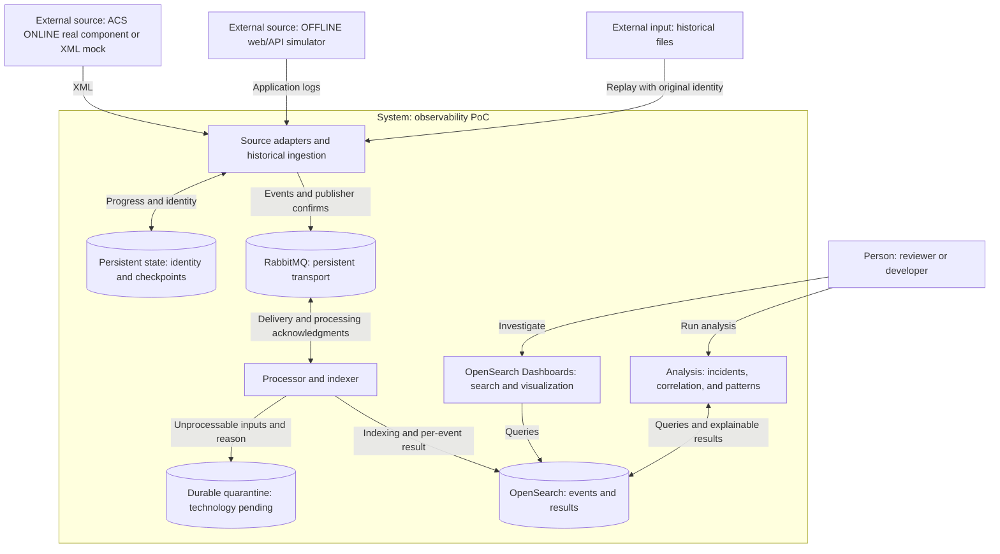

# Architecture: approved conceptual C4 views and pending detailed design

**Status:** conceptual C4 architecture approved by the owner on 3 November 2026 (America/Santiago); detailed engineering choices remain open. This does not represent an implemented architecture or ALMA's current infrastructure. [ADR-0001](../adr/0001-project-constraints.md) records owner constraints; [ADR-0002](../adr/0002-recovery-and-event-identity.md) proposes how to evaluate them.

## C4 level 1 — System context

| Element | C4 type | Responsibility and boundary |
| --- | --- | --- |
| Reviewer/developer | Person | Search logs, investigate incidents, and inspect evidence |
| Observability PoC | System under design | Transport, process, store, and analyze logs |
| ACS ONLINE source | External system | Identified real component or mock producing XML |
| Simulated OFFLINE application/API | External system | Produce reproducible operational and failure events |
| Historical files | External input resource | Identified immutable corpus available for replay |

ALMA production systems and operations are not part of this execution context.

## C4 level 2 — Approved logical containers

C4 containers represent execution/data units. This diagram does not require a separate process for every function or impose a physical topology. Adapters and replay can share one tool.

Normalization placement, raw/quarantine storage, and how analysis runs remain open. Processing may use a small application or an existing tool; Logstash is not assumed mandatory. OFFLINE goes through RabbitMQ by this PoC's design decision, not as a claim about the historical system.

## Level 3 and deployment

Level 4 is not required. Add level 3 only if it clarifies adapter/indexer internal responsibilities. A later deployment view will fix nodes, volumes, ports, resources, versions, and local exposure. The proposed demo does not require Kubernetes or multiple hosts.

## Execution constraints confirmed on 3 November 2026

Owner-provided constraints, not independently measured hardware:

| Item | Confirmed constraint |
| --- | --- |
| Host | Temporary development/demo host: the owner's current machine. A more powerful main PC is planned; its specifications are not yet recorded |
| CPU | Intel Core i5-11300H |
| Memory | 16 GB total host RAM, shared with the operating system and other applications |
| Storage | Up to 10 GB available for this project on the temporary host |
| Packaging | Docker Compose accepted by the owner on 3 November 2026; use the same approach on the future main PC |
| ACS investigation | At most two hours to assess a minimal real ACS producer/capture path; finish earlier if feasibility or a blocker becomes clear |

The two-hour limit is an investigation ceiling, not a duration estimate or a guarantee of real integration. Record the ACS release, candidate source, dependencies, estimated footprint, and outcome. If blocked at the limit or clearly incompatible with the resource budget earlier, document the reason and use the already approved XML mock fallback. Selecting a mock does not establish real ACS integration.

### Accepted packaging and proposed local deployment budget

The owner accepted Docker Compose as the packaging approach on 3 November 2026. The proposed service split is separate containers for OpenSearch, Dashboards, RabbitMQ, and the small project processes as needed. These services share the host's CPU, RAM, and disk; a container does not supply additional capacity. Exact versions, resource allocations, and service configuration remain detailed design work. No runtime configuration is introduced by this document.

The current hardware budget is temporary, not the project's permanent capacity ceiling. Keep paths, volumes, and resource settings configurable for the future main PC. On that host, record its specifications and repeat resource/capacity measurements; do not assume larger topology or high availability merely because more hardware is available.

- Start with one OpenSearch node and one RabbitMQ instance, persistent project volumes, and small bounded datasets. This is a restart/recovery demo, not a high-availability deployment.
- Target an initial combined memory budget of approximately 6–8 GB for the PoC, leaving room for the host and other applications. This is an engineering estimate to validate, not measured usage or an approved performance target. Set OpenSearch heap separately from its total process/container memory.
- Treat 10 GB as the full incremental project storage budget: downloaded/unpacked images, build cache, any ACS checkout/dependencies, raw data, broker/quarantine storage, indexes, runtime logs, and evidence. Images and build artifacts may be the limiting factor.
- Before installation, estimate the selected versions' complete footprint and verify actual free space in the runtime and volume filesystems. Keep growth headroom within the project budget; if the footprint does not fit, revise packaging or defer the real ACS environment before downloading/building it. Do not delete unrelated host data or promise that the complete stack fits before measurement.
- Bound source generation, backlog, quarantine, and runtime log growth. When capacity is reached, stop/pause production or ingestion with a visible reason while retaining recoverable records; do not silently discard accepted events.
- Pin compatible OpenSearch/Dashboards and RabbitMQ versions after the footprint review. Record deployment checks and peak usage in the [validation plan](../validation.md).

Packaging guidance: [official OpenSearch Docker documentation](https://docs.opensearch.org/latest/install-and-configure/install-opensearch/docker/), reviewed on 3 November 2026. It documents single-node deployment, Compose, persistent volumes, and explicit resource configuration; it does not certify this project's proposed budget.

## Questions to resolve in detailed design

| Question | Required evidence or decision |
| --- | --- |
| Which real ACS component is feasible within the deadline? | Source/version, dependencies, and criterion for fallback to a mock |
| How are file, generation, and occurrence identified? | CT-01 and counterexamples involving rotation/replay/repetition |
| When do checkpoints advance and messages get acknowledged? | ADR-0002 and CA-03/CA-04/CA-11 |
| Which tool processes and indexes events? | Brief comparison of complexity and support for guarantees |
| Where are raw records and quarantine retained? | Persistence, inspection, and replay without silent loss |
| Which index receives a late redelivery? | Stable destination identity throughout the replay window |
| How many nodes and which versions? | Available resources and goals; do not infer high availability |
| How can analysis stay small? | Initial rules and grouping; CT-04 and CA-08/CA-09 |

## What the remaining questions mean

Approval covers the logical layout above. These questions turn that layout into precise contracts and a reproducible deployment. Recommendations below are **proposed**, not owner decisions or verified runtime behavior.

| Question | Meaning and why it matters | Recommended starting point | Input or evidence needed |
| --- | --- | --- | --- |
| Real ACS component | Decide how real XML reaches our adapter. Running the full ACS environment may take more effort than the demo warrants. | Investigate a minimal real producer and an external XML capture/export path within an agreed time budget; use a documented mock if blocked. The supplied research identifies `acsXmlFileStore` as a candidate, not a confirmed working integration. | Owner confirmed a two-hour investigation ceiling. Engineering: identify any usable ACS environment, release, dependencies, format/schema, and reproducible evidence within the host budget. |
| File/generation/occurrence identity | A path can be reused after rotation. Two records with identical text can still be different occurrences. | Persist an archive/generation identity and record position; keep those coordinates on copies and replay. Use a persistent run identity and sequence for synthetic producers. Do not assume `LogId` is unique per occurrence. | CT-01: exact framing, rotation/truncation behavior, copied-file provenance, and identity examples. |
| Checkpoints and acknowledgments | A checkpoint says how far the adapter has safely progressed; an acknowledgment lets RabbitMQ remove a delivery. Doing either too early can lose data. | Advance only the contiguous source prefix confirmed as durably accepted and routed; acknowledge consumer deliveries only after successful indexing or confirmed durable quarantine. Retry uncertain outcomes with the original identity. | ADR-0002 and CT-02/CT-03: durable configuration, unroutable messages, partial bulk failures, confirmation loss, and backpressure. |
| Processing/indexing tool | Decide what parses XML/JSON, normalizes records, retries failures, and writes to OpenSearch. | Compare a small Python worker with Logstash before selecting. Favor explicit, inspectable control over occurrence identity and per-event results; avoid introducing both without a concrete need. | Brief comparison of code/configuration effort, dependency support, and guarantee coverage. |
| Raw records and quarantine | Raw records preserve the original input. Quarantine retains invalid records with the reason they could not be indexed, so one malformed event does not disappear or block the pipeline forever. | Retained source corpus on a persistent volume; raw record/reference in the envelope. Evaluate a durable RabbitMQ quarantine queue with confirmed publication before acknowledging the original, plus a way to inspect/export/reprocess it. | Storage limits, retention, full-disk behavior, restart persistence, and quarantine failure handling. |
| Destination index | The same `event_id` written to different indexes can still produce two searchable copies. | One fixed concrete events index for the bounded demo; separate analysis results. Keep retention/rollover outside the guaranteed replay window and document the policy. | CT-03: index naming, reprocessing/result-version policy, retention, and supported replay window. |
| Nodes and versions | Choose how many instances run, which exact releases they use, and the resources/ports/volumes required. | One local RabbitMQ, one OpenSearch node, and matching Dashboards for the essential demo. Pin compatible versions after checking resources. This does not demonstrate high availability. | Host confirmed above: i5-11300H, 16 GB total RAM, 10 GB project storage; native or local Docker acceptable. Engineering: node/resource allocation, exact versions, and measured footprint. |
| Small analysis scope | Define useful correlation and patterns without turning the demo into a general analytics platform. | One synthetic incident; one or two rules based on observed identifiers and time windows; grouping of normalized messages with counts and examples. Explain every link and disclose synthetic cross-source relationships. | CT-04 and CA-08/CA-09: expected inputs/outputs, rule versions, windows, and false-link examples. |

### How the supplied ACS investigation informs the next stage

See [S-05](../references/README.md#s-05--supplied-acs-documentation-investigation). The report is documentary research; its underlying links were not independently revalidated in this update.

- It identifies XML archives and `acsXmlFileStore` as possible integration boundaries, with AMQP/Kafka handlers to investigate. Their presence in documentation does not establish active production configuration.
- It warns that `LogId` describes a class/type of event rather than proving a globally unique occurrence ID. The independent identity contract remains necessary.
- It reports TAI timestamps in the manual. CT-01 must preserve the original timestamp and time scale and define validated conversion for time-based searches; do not silently assume UTC.
- Its broader migration/production questions are a research checklist, not additional prerequisites for this personal demo. Current ALMA versions, deployment, and retention remain unverified.

### Approval record

- Owner message: **"i approve the architecture, but need to explain me the questions to answer"**.
- Date: **3 November 2026, America/Santiago**.
- Approved baseline: this document's conceptual C4 views at revision `5e28f390edba5881269471d1cfd2e1401e56f322`.
- Detailed recommendations above, ADR-0002, contracts, deployment values, and quantitative targets remain open. Implementation has not started.

## Relationship to the historical reference

Inspiration is limited to source separation, centralization, and decoupling through messaging. The adaptation to OpenSearch, identity contracts, and this demo's guarantees are project-specific decisions. The documentary mapping is in [references](../references/README.md).
