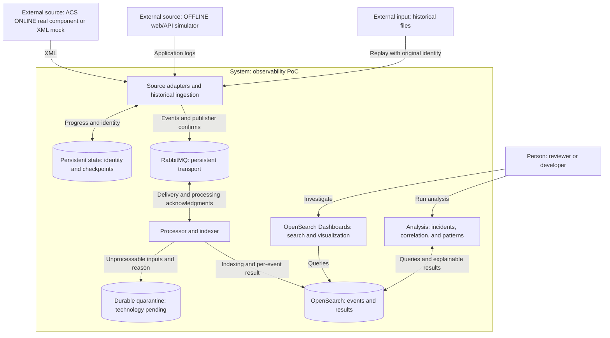

# Architecture: C4 views and pending evaluation

**Status:** conceptual/proposed. This does not represent an implemented architecture or ALMA's current infrastructure. [ADR-0001](../adr/0001-project-constraints.md) records owner constraints; [ADR-0002](../adr/0002-recovery-and-event-identity.md) proposes how to evaluate them.

## C4 level 1 — System context

| Element | C4 type | Responsibility and boundary |
| --- | --- | --- |
| Reviewer/developer | Person | Search logs, investigate incidents, and inspect evidence |
| Observability PoC | System under design | Transport, process, store, and analyze logs |
| ACS ONLINE source | External system | Identified real component or mock producing XML |
| Simulated OFFLINE application/API | External system | Produce reproducible operational and failure events |
| Historical files | External input resource | Identified immutable corpus available for replay |

ALMA production systems and operations are not part of this execution context.

## C4 level 2 — Proposed logical containers

C4 containers represent execution/data units. This diagram does not require a separate process for every function or impose a physical topology. Adapters and replay can share one tool.

Normalization placement, raw/quarantine storage, and how analysis runs remain open. Processing may use a small application or an existing tool; Logstash is not assumed mandatory. OFFLINE goes through RabbitMQ by this PoC's design decision, not as a claim about the historical system.

## Level 3 and deployment

Level 4 is not required. Add level 3 only if it clarifies adapter/indexer internal responsibilities. A later deployment view will fix nodes, volumes, ports, resources, versions, and local exposure. The proposed demo does not require Kubernetes or multiple hosts.

## Questions to evaluate before finalizing the architecture

| Question | Required evidence or decision |
| --- | --- |
| Which real ACS component is feasible within the deadline? | Source/version, dependencies, and criterion for fallback to a mock |
| How are file, generation, and occurrence identified? | CT-01 and counterexamples involving rotation/replay/repetition |
| When do checkpoints advance and messages get acknowledged? | ADR-0002 and CA-03/CA-04/CA-11 |
| Which tool processes and indexes events? | Brief comparison of complexity and support for guarantees |
| Where are raw records and quarantine retained? | Persistence, inspection, and replay without silent loss |
| Which index receives a late redelivery? | Stable destination identity throughout the replay window |
| How many nodes and which versions? | Available resources and goals; do not infer high availability |
| How can analysis stay small? | Initial rules and grouping; CT-04 and CA-08/CA-09 |

## Relationship to the historical reference

Inspiration is limited to source separation, centralization, and decoupling through messaging. The adaptation to OpenSearch, identity contracts, and this demo's guarantees are project-specific decisions. The documentary mapping is in [references](../references/README.md).
