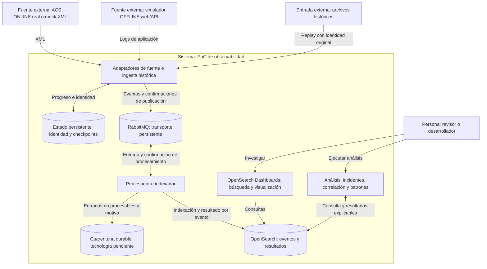

# Arquitectura: vistas C4 y evaluación pendiente

**Estado:** conceptual/propuesto. No representa una arquitectura implementada ni la infraestructura actual de ALMA. [ADR-0001](../adr/0001-project-constraints.md) recoge restricciones recibidas; [ADR-0002](../adr/0002-recovery-and-event-identity.md) plantea cómo evaluarlas.

## C4 nivel 1 — Contexto

| Elemento | Tipo C4 | Responsabilidad y límite |
| --- | --- | --- |
| Revisor/desarrollador | Persona | Buscar logs, investigar incidentes e inspeccionar la evidencia |
| PoC de observabilidad | Sistema bajo diseño | Transportar, procesar, almacenar y analizar logs |
| Fuente ACS ONLINE | Sistema externo al PoC | Componente real o mock identificado que produce XML |
| Aplicación/API OFFLINE simulada | Sistema externo al PoC | Producir eventos de operación y fallo reproducibles |
| Archivos históricos | Recurso externo de entrada | Corpus inmutable identificado, disponible para replay |

Ni sistemas productivos de ALMA ni su operación forman parte de este contexto de ejecución.

## C4 nivel 2 — Contenedores lógicos propuestos

Los contenedores C4 representan unidades de ejecución/datos. Este diagrama no impone un proceso separado para cada función ni una topología física. Los adaptadores y el replay pueden compartir una sola herramienta.

La ubicación de la normalización, el almacenamiento de raw y cuarentena, y la forma de ejecutar análisis siguen abiertas. El procesamiento puede ser una aplicación pequeña o una herramienta existente; Logstash no se da por obligatorio. OFFLINE pasa por RabbitMQ por decisión de este PoC, no por una afirmación sobre el sistema histórico.

## Nivel 3 y despliegue

No se requiere nivel 4. El nivel 3 se añadirá solo si aclara responsabilidades internas del adaptador/indexador. Una vista de despliegue posterior fijará nodos, volúmenes, puertos, recursos, versiones y exposición local. La demo propuesta no requiere Kubernetes ni múltiples hosts.

## Preguntas para evaluar antes de cerrar la arquitectura

| Pregunta | Evidencia o decisión necesaria |
| --- | --- |
| ¿Qué componente ACS real es viable en el plazo? | Fuente/versión, dependencias y criterio de fallback a mock |
| ¿Cómo identificar archivo, generación y ocurrencia? | Contrato CT-01 y contraejemplos de rotación/replay/repetición |
| ¿Cuándo avanzar checkpoint y confirmar mensajes? | ADR-0002 y escenarios CA-03/CA-04/CA-11 |
| ¿Qué herramienta procesa e indexa? | Comparación breve por complejidad y soporte de garantías |
| ¿Dónde conservar raw y cuarentena? | Persistencia, inspección y reproceso sin pérdida silenciosa |
| ¿Qué índice recibe una reentrega tardía? | Identidad estable de destino durante la ventana de replay |
| ¿Cuántos nodos y qué versiones? | Recursos disponibles y objetivos; no deducir alta disponibilidad |
| ¿Cómo mantener pequeño el análisis? | Reglas y agrupación iniciales; interfaces CT-04 y CA-08/CA-09 |

## Relación con la referencia histórica

La inspiración se limita a separación de fuentes, centralización y desacoplamiento mediante mensajería. La adaptación a OpenSearch, los contratos de identidad y las garantías de esta demo son decisiones propias. La correspondencia documental está en [referencias](../references/README.md).
