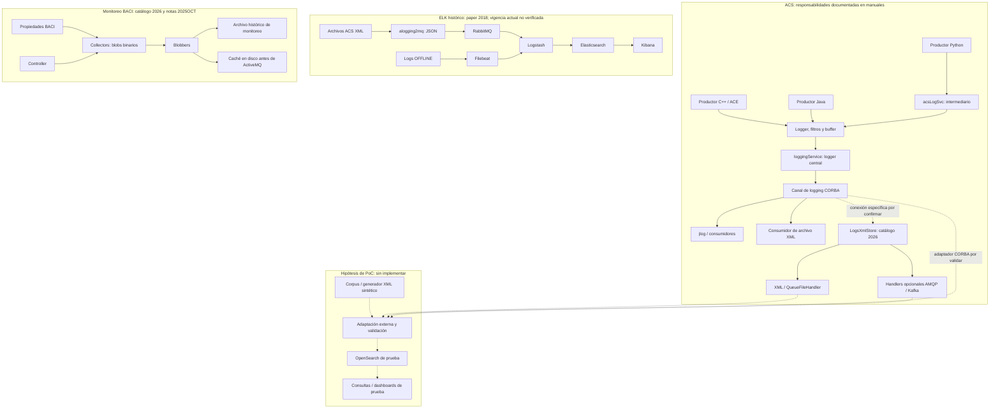

# Investigación documental de ALMA: logging, observabilidad y antecedentes para OpenSearch

Fecha de consulta: **30 de octubre de 2026**. Alcance: investigación de solo lectura con acceso público, confirmada por el usuario. No se modificaron páginas ni sistemas y no se implementó el PoC.

La documentación permite reconstruir el recorrido de logs ACS e identificar interfaces externas para una prueba de concepto. **No permite establecer la topología, versión, seguridad ni retención del Elasticsearch de producción actual.** Hay antecedentes posteriores al paper de 2018 sobre Kafka y almacenamiento XML, pero no prueban que RabbitMQ haya sido reemplazado en el pipeline ELK.

## Alcance, método y confianza

Se examinaron **34 páginas de Confluence**, contando índices, guías, especificaciones, propuestas y notas de versiones. En documentos extensos, la lectura se concentró en las secciones de logging, distribución, almacenamiento, monitoreo y seguridad. También se consultaron las listas de adjuntos del manual y del taller CORBA, y el texto público del paper de referencia. No se descargaron espacios completos ni se exportaron documentos originales en lote.

La exploración comenzó en ICTACS y en las tres páginas solicitadas. Se siguieron índices, navegación lateral, relaciones padre/hijo y referencias pertinentes, normalmente hasta dos saltos desde cada documento prioritario. Los resultados de búsqueda introdujeron nuevos documentos prioritarios. La ampliación de 30 a 34 páginas responde a referencias particularmente útiles sobre Kafka, archivado y medición de recursos.

El navegador mostró «Log in» y el buscador avisó que una cuenta ampliaría los resultados. Por tanto, **ausencia de resultados significa ausencia en la vista pública consultada**, no ausencia de documentación interna ni de la tecnología en ALMA. Las búsquedas globales mostraron ocasionalmente otros espacios públicos; no apareció una página de otro espacio que justificara extender la lectura técnica fuera de ICTACS.

Convenciones:

- **D — Documentado:** afirmación explícita en una fuente consultada; no certifica despliegue actual.
- **H — Histórico/propuesta:** evidencia con fecha o estado que limita su aplicabilidad.
- **I — Inferencia:** conclusión razonada o posibilidad para el PoC, pendiente de validación.
- **NV — No verificado:** dato que no se pudo establecer con las fuentes disponibles.

La fecha de edición de Confluence no equivale a la fecha de diseño ni de despliegue. Ejemplos: la página de arquitectura se editó en 2021, pero contiene un borrador de 2009; una FAQ publicada en 2020 conserva una respuesta de 2004. [D16][D16] [D10][D10]

## A. Inventario documental

Todos los documentos de esta tabla pertenecen a **ICTACS — ICT ALMA Common Software**. La fecha corresponde a la edición visible, salvo indicación contraria. Los identificadores D permiten seguir las relaciones dentro de este informe.

| ID | Documento y enlace directo | Espacio | Fecha / versión visible | Tema y propósito | Utilidad para migración o PoC | Documentos relacionados |
|---|---|---|---|---|---|---|
| D01 | [Pages — ICTACS][D01] | ICTACS | Consulta 2026-10-30; índice dinámico | Árbol y actividad del espacio | Orientación; no describe producción | D12, D13, D16, releases |
| D02 | [Logging and archiving Manual][D02] | ICTACS | 2025-05-15 | Diseño de logging, APIs, XML y archivado BACI | Alta: contrato de eventos, buffers, filtros y consumidores | D03, D05, D16, D17 |
| D03 | [ACS Technical Documents — Logging System][D03] | ICTACS | 2023-03-08 | Separa tecnologías, implementaciones, canal y servicios | Alta: delimita responsabilidades | D06, D07, D05 |
| D04 | [ACS Workshop — Distributed Systems and CORBA Standard][D04] | ICTACS | 2025-05-06 | Introducción a distribución, CORBA y ACS; materiales adjuntos | Contexto; sin configuración ELK en el cuerpo | Material de talleres; anexos 2020/2022/2025 |
| D05 | [Notification Channel][D05] | ICTACS | 2025-04-25 | Eventos estructurados, APIs, QoS, CDB y reconexión | Alta: contrato y riesgos de un consumidor externo | D02, D03, D19 |
| D06 | [Logging System — C++ ACE Logger Implementation][D06] | ICTACS | 2024-04-03 | Clases, handlers, servicios y consumidores | Alta: interfaz `writeRecords`, destinos archivo/syslog | D03, D07 |
| D07 | [Logging System — C++ Boost Log Implementation][D07] | ICTACS | 2024-04-03; se declara propuesta | Rediseño de implementación C++ | Media: evolución potencial; despliegue NV | D03, D06, D08 |
| D08 | [Logging][D08] | ICTACS | 2022-04-11; PLANNING | Modernización C++; retirada de log4cpp | Alta para evitar asumir tecnologías obsoletas | D09, D07 |
| D09 | [Logging System Performance Study][D09] | ICTACS | 2022-04-12 | Micropruebas con 10.000 mensajes; contención y latencia | Alta para definir mediciones; no dimensiona producción | D08, D06 |
| D10 | [How can store logs and browse them later offline?][D10] | ICTACS | Publicada 2020-05-15; respuesta 2004-08-31 | Persistencia mediante Logging Client y lectura con jlog | Alta: antecedente simple de captura XML | D02, D25 |
| D11 | [ACS Logging System][D11] | ICTACS | 2025-04-25 | Página de tutorial | Baja: sin contenido técnico útil visible | D22, D23, D24 |
| D12 | [ACS Documentation][D12] | ICTACS | 2020-04-02 | Índice de documentación | Orientación hacia documentos técnicos | D13 |
| D13 | [ACS Technical Documents][D13] | ICTACS | 2020-05-15 | Índice de manuales, tutoriales y especificaciones | Alta para navegación; una macro de encuesta sin permiso | D02, D05, D17 |
| D14 | [ACS Software — monitoring][D14] | ICTACS | 2026-03-13 | Collectors, blobbers, controlador y acceso histórico | Alta para separar monitoreo BACI de logs | D15, D28 |
| D15 | [ACS Software — CommonSoftware][D15] | ICTACS | 2026-03-12 | Catálogo de módulos | Alta como mapa; contiene discrepancias que exigen contraste | D14, D25, D26, D33 |
| D16 | [ACSArchitecture][D16] | ICTACS | Página 2021-02-02; versión F, Draft, 2009-04-15 | Arquitectura ACS; logging §3.8 | Alta para historia y decisiones; vigencia limitada | D02, D05, D17 |
| D17 | [Management and Access Control Interface Specification][D17] | ICTACS | 2025-04-25 | Manager, clientes, autorización y ciclo de vida | Media: seguridad MACI; no acredita SSO de ELK | D02, D16 |
| D18 | [ACS Community Meeting — 2021 Q1][D18] | ICTACS | 2021-02-11 | Agenda de comunidad y obsolescencia | Referencia explícita a uso de Elastic Search; sin arquitectura | D08, documentación de comunidad |
| D19 | [Notification Channel API replacement][D19] | ICTACS | 2020-04-02 | Plan para sustituir transporte preservando API | Contexto de evolución; no prueba sustitución | D20, D05 |
| D20 | [Summer Student Project — Notification Channel API Replacement][D20] | ICTACS | 2021-03-15 | Estudio y elección de Artemis para el proyecto | Media: requisitos de desacoplamiento y QoS | D19, D27; adjuntos DDS y presentación |
| D21 | [What are archive monitors and how do they work?][D21] | ICTACS | Publicada 2020-05-13 | CDB, disparadores BACI y ArchiveConsumer | Alta: semántica de archivado | D02, D14 |
| D22 | [Logging in Java][D22] | ICTACS | Creada 2022-10-26 | Subpágina de tutorial | Baja: sin explicación técnica visible | D11, D02 |
| D23 | [Logging in C++][D23] | ICTACS | Creada 2022-10-26 | Subpágina de tutorial | Baja: sin explicación técnica visible | D11, D06 |
| D24 | [Logging in Python][D24] | ICTACS | Creada 2022-10-26 | Subpágina de tutorial | Baja: sin explicación técnica visible | D11, D02 |
| D25 | [ACS Software — acsGUIs][D25] | ICTACS | 2026-03-13 | jlog, logTools, logLevelGUI y eventGUI | Media: herramientas y consultas que inventariar | D15, D10 |
| D26 | [ACS Software — ACSLaser][D26] | ICTACS | 2026-03-13 | Alarmas LASER, JMS, persistencia y profiler | Media: dominio de alarmas distinto del índice de logs | D15, D25 |
| D27 | [ActiveMQ Artemis Details][D27] | ICTACS | Creada 2021-03-15 | Página de detalles del proyecto | Baja: sin detalles técnicos visibles | D20 |
| D28 | [COMMON-2025OCT][D28] | ICTACS | 2026-06-10; release 2025OCT | Cambios Python logging y caché Blobber → ActiveMQ | Alta: evolución concreta en notas de versión | D14, D29 |
| D29 | [COMMON-2026OCT][D29] | ICTACS | 2026-09-29; release 2026OCT | Cambios Log4j, NC, dependencias y pruebas | Alta: mantenimiento reciente; no topología ELK | D30, D15 |
| D30 | [Java Dependencies][D30] | ICTACS | 2026-08-17 | Versiones actuales según tabla, objetivos e historial | Alta para librerías; no establece versión Elasticsearch | D29, D08 |
| D31 | [COMMON-2020JUN — 2020-04][D31] | ICTACS | 2020-10-09 | Requisitos de homogeneización XML/Kafka y reingesta | Alta: pista de evolución del pipeline | D34, D33 |
| D32 | [BulkDataNT WSU Performance Analysis][D32] | ICTACS | 2025-07-31 | Plan de pruebas y medición de recursos | Media: propone «Graphana» o similar; despliegue NV | BulkData / WSU |
| D33 | [ACS Software — acsExtras][D33] | ICTACS | 2026-03-13 | `acsXmlFileStore`, XML, AMQP y Kafka | Muy alta: interfaz externa candidata para ingesta | D15, D31, D34 |
| D34 | [COMMON-2020OCT — 2020-08][D34] | ICTACS | 2020-08-13 | Revisión de prioridades XML/Kafka | Alta: dice que el enfoque se abordaría en otro lugar | D31, D33 |

### Jerarquía y mapa de referencias

El árbol visible de ICTACS contiene ACS Community, ACS Learning, ACS Documentation, ACS Workshops, ACS Procedures, ACS Projects, ACS Releases, ACS Roadmap y ACSArchitecture. Las ramas relevantes recorridas fueron:

- **ACS Documentation → ACS Technical Documents:** manual, Notification Channel, MACI y Logging System → implementaciones ACE/Boost.
- **ACS Workshops → ACS Workshop Material → Basic Topics:** taller de sistemas distribuidos/CORBA.
- **ACS Tutorials → ACS Logging System:** subpáginas por lenguaje; poco contenido visible.
- **ACS Software Description → CommonSoftware:** monitoring, acsGUIs, ACSLaser y acsExtras.
- **ACS Projects:** modernización C++, reemplazo del canal y estudio de rendimiento.
- **ACS Releases / Requirements Gathering / Community:** cambios de versiones y planes históricos.

El manual enlaza especificaciones OMG Telecom Log y Notification Service, documentación ACE, documentación Java y esquemas ACS alojados en ESO. Son referencias externas identificadas; no se verificó íntegramente su disponibilidad ni su correspondencia con el ACS hoy desplegado. No se localizaron enlaces técnicos suficientes para reconstruir un espacio interno de SOFTOPS/FLSSE desde la vista pública. [D01][D01] [D02][D02] [D13][D13]

### Adjuntos y calidad documental

- **Manual:** seis PNG listados, dos de abril de 2019 y cuatro importados desde Word en diciembre de 2018. El cuerpo identifica diagramas de arquitectura de logging, ACE y Java. Se verificó la existencia y metadatos de los adjuntos; no se hizo una transcripción visual independiente de cada imagen. [Adjuntos del manual](https://confluence.alma.cl/pages/viewpageattachments.action?pageId=25790043)
- **Taller CORBA:** PDF `01- ACS - Distributed Systems and CORBA Standard.pdf` de mayo de 2025, PPTX y PDF de octubre de 2022, y PDF del taller de julio de 2020. El cuerpo explica su propósito introductorio. No se leyó íntegramente cada presentación adjunta. [Adjuntos del taller](https://confluence.alma.cl/pages/viewpageattachments.action?pageId=57934051)
- **Proyecto NC:** referencias a un PDF sobre DDS y a una presentación inicial del proyecto. Identificados, sin revisión completa de sus adjuntos. [D20][D20]
- **Esquemas:** el manual identifica `loggingMI.xsd` y `ACSLogTS.xsd`; el primero se remite a documentación externa y al repositorio. No se obtuvo un XSD validado contra la versión instalada. Hay ejemplos XML con errores de conversión/renderizado, por lo que no deben copiarse como fixtures sin corregir y validar. [D02][D02]

## B. Informe técnico

### 1. Arquitectura de logging de ACS

**D:** ACS separa la generación y filtrado por lenguaje, la centralización y la distribución a consumidores. El sistema utiliza interfaces derivadas de CORBA Telecom Log Service y canales de CORBA Notification Service. El documento de implementación ACE identifica al logger central como `loggingService` y a `acsLogSvc` como intermediario que recibe llamadas individuales, principalmente de Python, y las incorpora al flujo C++. No son dos nombres intercambiables del mismo papel. [D03][D03] [D06][D06]

Flujo reconstruido:

1. Un componente, contenedor o cliente genera un mensaje mediante su API de logging.
2. El logger/handler añade contexto y aplica niveles de filtrado; puede enviar a consola, archivo y/o ruta central.
3. Se formatean registros y, según configuración, se agrupan o almacenan temporalmente antes del envío. Python utiliza el servicio intermediario indicado.
4. El logger central recibe registros mediante CORBA y los publica en el canal de logging.
5. Consumidores independientes los visualizan, escriben o encaminan hacia almacenamiento externo.

**Límite:** esto reconstruye responsabilidades documentadas, no un inventario de procesos activos en producción. [D02][D02] [D03][D03] [D06][D06]

### 2. Generación, distribución y contratos

| Aspecto | Evidencia | Consecuencia para la investigación del PoC |
|---|---|---|
| C++ | ACE, macros ACS, `LoggingProxy`, handlers y caché. Boost aparece como propuesta. | No depender del rediseño Boost para construir el generador. |
| Java | Manual basado en `java.util.logging`; documento 2023 enumera además SLF4J y Log4j2. | Identificar la integración efectiva de cada aplicación; no asumir un único frontend. |
| Python | Extensión de `logging.Logger`, handler local y handler central mediante `acsLogSvc`. | Se puede imitar el evento final sin emular todo CORBA. |
| XML | Tipo de elemento expresa severidad; atributos de contexto y elementos `Data Name=…`. | Preservar estructura y mensaje original al estudiar una transformación a JSON. |
| Interfaces | Manual: `write_records`; implementación: `AcsLogService` extiende `DsLogAdmin::BasicLog` con `writeRecords` y `getStatistics`. | Hay diferencias de nivel/época; obtener IDL exacta antes de desarrollar un consumidor. |
| Distribución | Eventos estructurados y consumidores conectados a canales con nombres acordados. | Un adaptador necesita el contrato específico de logging; el ejemplo genérico de NC no basta. |

Fuentes: [manual][D02], [panorama de logging][D03], [implementación ACE][D06], [Notification Channel][D05].

El evento XML genérico documenta `TimeStamp`, `File`, `Line`, `Routine`, `Host`, `Process`, `Thread`, `Context`, `SourceObject`, `StackId`, `StackLevel`, `LogId`, `Uri`, `Priority`, mensaje y pares `Data`. No todos son obligatorios. `LogId` identifica una clase de evento: **no debe suponerse un identificador único por ocurrencia** para deduplicación. Se documentan niveles TRACE, DELOUSE, DEBUG, INFO, NOTICE, WARNING, ERROR, CRITICAL, ALERT y EMERGENCY, así como audiencias y contexto de array/antena. [D02][D02]

El manual exige distinguir tiempo de generación y tiempo de recepción: el buffering puede separarlos. Además declara el timestamp XML en **TAI** y con milisegundos, mientras los requisitos generales mencionan resolución de 100 ns. Hay inconsistencias en ejemplos y valores de prioridades. **I:** la normalización temporal debe conservar el valor original y confirmar escala/resolución reales; no interpretar automáticamente una cadena sin zona como UTC ni tratar todos los números de severidad como equivalentes. [D02][D02]

**H:** el borrador arquitectónico de 2009 cuenta un experimento de transporte binario de logs que empeoró tamaño y rendimiento frente a XML. Eso es una decisión histórica, no una prueba del transporte actual. Los blobs binarios del monitoreo BACI pertenecen a otra ruta y no contradicen necesariamente esa decisión. [D16][D16] [D14][D14]

El canal documenta reconexión automática, configuración QoS/administrativa mediante CDB y límites de colas. También advierte que algunas propiedades de fiabilidad no están implementadas por TAO en el contexto descrito, que pueden descartarse eventos y que consumidores lentos perjudican el servicio. **No se puede convertir el requisito «no descartar eventos» en una garantía de entrega comprobada.** [D05][D05]

### 3. Almacenamiento, archivado y retención

**D/H:** el manual y la arquitectura dejan la persistencia permanente en manos de consumidores/aplicaciones; describen un Database Logger y alternativas de consulta como posibilidades, sin acreditar una base SQL concreta instalada. La FAQ histórica muestra captura del Logging Client a XML y posterior apertura en jlog. [D02][D02] [D16][D16] [D10][D10]

**D:** el catálogo `acsExtras` de 2026 describe `acsXmlFileStore`: `LogsXmlStore` y `AlarmsXmlStore` guardan eventos en XML, `QueueFileHandler` gestiona archivo/buffering y hay handlers opcionales AMQP y Kafka. Es el punto documental más concreto para investigar una salida a sistemas externos sin cambiar los productores ACS. **NV:** no se comprobó qué componentes o handlers están habilitados en ALMA ni sus garantías de entrega. [D33][D33]

El archivado de propiedades BACI se configura con `archive_min_int`, `archive_max_int` y `archive_delta`; el manual también describe `archive_priority`. La ruta histórica utiliza un canal de archivado y consumidores `ArchiveConsumer`. Son políticas de muestreo/publicación, **no plazos de retención de índices**. [D02][D02] [D21][D21]

No se encontraron políticas actuales de rotación de XML, conservación de índices, borrado, snapshots, recuperación o almacenamiento de largo plazo. Tampoco volúmenes actuales por fuente. **I:** las pruebas deben contemplar replay, registros repetidos, llegada tardía y archivos truncados/rotados; son escenarios a validar, no fallos observados en producción.

### 4. Infraestructura Elasticsearch/ELK documentada

**H — paper de julio de 2018:** documenta el puente ONLINE `ACS → XML → alogging2mq → RabbitMQ → Logstash → Elasticsearch → Kibana`; el puente transforma a JSON sin intervenir el servicio ACS. Describe incorporación de OFFLINE mediante Filebeat y Logstash, y evolución desde LogAAA hacia un clúster con particionamiento y redundancia. También distingue logs del sistema operativo de logs de aplicaciones. [Paper, texto publicado por sus autores](https://www.researchgate.net/publication/326236739_Current_status_of_software_log_analysis_at_ALMA_Observatory)

**D/H — Confluence:** una agenda de 2021 enumera como tema documental el diseño de logging y el uso de Elastic Search en ALMA. No aporta versiones, endpoints, inventario de nodos ni configuraciones. [D18][D18]

| Información buscada | Resultado de la documentación pública examinada |
|---|---|
| Arquitectura ELK | Antecedente histórico en el paper; Confluence no aporta una descripción actual completa. |
| Versiones Elasticsearch/Kibana/Logstash/Filebeat | NV; las versiones Java del inventario no identifican versiones del stack ELK. |
| Ingesta actual ONLINE/OFFLINE | NV. XML/AMQP/Kafka tienen antecedentes ACS, sin trazabilidad completa hasta el Elasticsearch actual. |
| Índices, mappings, templates, aliases | No localizados. |
| Retención y snapshots actuales | No localizados. |
| Nodos, roles, shards, réplicas, capacidad y disponibilidad | No establecidos para producción actual. |
| Dashboards, consultas y objetos guardados | Sin inventario ni exportaciones actuales. |
| SSO, TLS y permisos de ELK | Sin configuración encontrada. |
| Incidencias actuales del clúster | No localizadas; algunas macros Jira no permiten ver los tickets. |

La afirmación sobre la edición gratuita de Elasticsearch y las limitaciones de autenticación/anomalías procede del contexto entregado por el usuario. **No fue corroborada con una ficha pública actual del proyecto ni con configuración del clúster.** No permite identificar por sí sola la versión, distribución, licencia exacta o funciones habilitadas.

### 5. Monitoreo de aplicaciones y métricas de hosts

Es necesario separar cuatro dominios documentales:

1. **Logs ACS:** eventos de ejecución y diagnóstico, con severidad y contexto. [D02][D02]
2. **Estadísticas de logging:** conteos y tasas por logger, reportadas por su mismo canal. El manual indica que están deshabilitadas por defecto y que el cálculo puede depender de la llegada de mensajes. No son una métrica completa de salud ni una sonda periódica garantizada. [D02][D02] [D06][D06]
3. **Propiedades BACI:** el catálogo de monitoreo describe collector → blobber → archivo histórico, con controlador que asigna collectors y trata fallos. Los collectors serializan muestras a blobs binarios. Las notas 2025OCT añaden caché en disco antes de enviar datos del Blobber a ActiveMQ. Son evidencias complementarias de la ruta de monitoreo, no prueba de ingesta en Elasticsearch. [D14][D14] [D28][D28]
4. **Alarmas:** LASER, JMS y herramientas como AlarmSystemProfiler constituyen otro subsistema; publicar una alarma no equivale a ejecutar detección de anomalías sobre índices. [D26][D26]

Para CPU, RAM, disco y red, el plan BulkDataNT/WSU pide medir recursos con «Graphana» o infraestructura equivalente. Es un **requisito de un estudio**, no evidencia de una instalación operativa de Grafana ni de agentes de host concretos. No se identificó una arquitectura actual de métricas de hosts, trazas distribuidas o correlación general entre señales. [D32][D32]

### 6. Seguridad y autenticación

**D:** la especificación MACI describe autenticación/autorización a través del Manager y tokens para llamadas posteriores, además de privilegios administrativos. Es seguridad del dominio de componentes ACS; no demuestra integración de Kibana, Elasticsearch u OpenSearch con un directorio corporativo. [D17][D17]

**NV:** proveedor de identidad corporativo, protocolos SSO, roles de usuarios de logs, segregación por entorno, acceso de ingesta, cifrado, auditoría y requisitos de conservación de datos sensibles. No se consultaron sistemas de identidad ni se recopilaron configuraciones de credenciales.

**I:** para el PoC conviene acordar identidades de prueba, acceso de solo lectura a las fuentes y datos sintéticos o muestras sanitizadas. La selección de protocolos y permisos de producción depende de requisitos que ALMA debe confirmar; no corresponde deducirlos de MACI.

### 7. Evolución histórica y discrepancias

| Fecha / ámbito | Evidencia | Lo que permite concluir |
|---|---|---|
| 2009, arquitectura F | XML, consumidores y persistencia a cargo de aplicaciones | Base histórica; no inventario actual. [D16][D16] |
| 2018, paper | Integración ELK histórica | Antecedente que requiere contraste con producción. [Paper](https://www.researchgate.net/publication/326236739_Current_status_of_software_log_analysis_at_ALMA_Observatory) |
| 2020, requisitos | Homogeneizar XML y Kafka para facilitar reingesta; después se indica que se abordaría en otro lugar | Kafka es una pista documentada; no acredita reemplazo de RabbitMQ. [D31][D31] [D34][D34] |
| 2020DEC / 2022, modernización | Retirada de log4cpp descrita como realizada; Boost todavía en planificación | Evitar tomar listas genéricas de tecnologías como inventario vigente. [D08][D08] |
| 2021, proyecto NC | Artemis elegido para un proyecto de reemplazo | Elección del proyecto, sin prueba de despliegue general. [D20][D20] |
| 2024, logging | Documentación ACE y propuesta Boost | Coexisten descripción de implementación y diseño futuro. [D06][D06] [D07][D07] |
| 2025OCT, notas | Correcciones de logging Python y caché Blobber → ActiveMQ | Cambios concretos de software documentados; despliegue exacto NV. [D28][D28] |
| 2026, catálogos y notas | XML/AMQP/Kafka, mantenimiento Log4j y Notification Channel | Evolución ACS reciente; no fecha de migración ELK. [D33][D33] [D29][D29] |

**Discrepancias que no deben resolverse por intuición:**

- D15 denomina `loggingts` un servicio de timestamps, mientras D02 lo relaciona con generación de logs *type safe* y `ACSLogTS.xsd`. Hace falta contrastar código y documentación de la release correspondiente.
- D15 describe Java sobre Log4j; el manual desarrolla JUL y D03 enumera varios frontends. Puede haber evolución o coexistencia; no se verificó la relación exacta.
- D03 enumera Log4CPP como tecnología, pero D08 afirma su retirada en 2020DEC. La segunda afirmación describe un cambio concreto y debe advertirse al usar el panorama general.
- D15 presenta capacidades generales de QoS/archivo de eventos; D05 detalla limitaciones de implementación. No se deben inferir garantías operativas de una descripción resumida.

Estas diferencias hacen que un catálogo editado en 2026 sea útil como mapa, pero insuficiente como fuente única de contratos o garantías. [D02][D02] [D03][D03] [D05][D05] [D08][D08] [D15][D15]

### 8. Posibles puntos de integración con OpenSearch

Son **alternativas de investigación**, no decisiones de migración:

| Punto | Base documental | Hipótesis para el PoC | Falta confirmar |
|---|---|---|---|
| Archivo XML archivado | D02, D10, D33 | Leer una copia/salida de prueba, transformar fuera de ACS e indexar | XSD, framing, rotación, codificación y escala temporal |
| AMQP / Kafka de `acsXmlFileStore` | D33; contexto D31/D34 | Consumir una salida de prueba ya desacoplada | Activación real, formato, ACK/replay, orden y duplicados |
| Consumidor de logging CORBA | D05, D06 | Adaptador externo con contrato específico | IDL, canal y payload exactos; impacto de un consumidor lento |
| Pipeline Logstash existente | Antecedente del usuario/paper | Evaluar conservación de filtros y sustitución de destino | Versiones, plugins y configuración sanitizada real |
| Datos ya indexados | Sin inventario actual localizado | Ensayar lectura/exportación o mecanismo compatible en laboratorio | Versiones origen/destino, mappings, snapshots y APIs soportadas |

**I — candidato mínimo:** generador o corpus XML sintético basado en ACS → transformación externa validada → índice de prueba en OpenSearch → consultas de comprobación. Es la hipótesis con menor cantidad de supuestos sobre brokers y servicios de producción. No prueba aún compatibilidad con el sistema real ni decide la estrategia final. Si ALMA confirma una salida AMQP/Kafka estable, esta podría sustituir la lectura de archivo en una etapa posterior. [D02][D02] [D33][D33]

No se afirma compatibilidad directa de snapshots, clientes, plugins ni objetos de Kibana con OpenSearch: faltan las versiones y artefactos concretos para evaluarla.

### 9. Información faltante para planificar una migración

Se necesitan: inventario de versiones y distribución; fuentes activas; esquema de eventos; configuración sanitizada de ingesta; índices/templates/mappings; políticas de retención y backups; topología/capacidad; objetos guardados y consumidores de API; requisitos de identidad; restricciones de operación; y criterios de aceptación.

Además, debe reconstruirse la trazabilidad **productor → archivo/canal/broker → transformaciones → índice → dashboard/usuario**. Las páginas examinadas cubren bien el lado ACS, pero dejan sin cerrar la conexión con el buscador de producción. Conocer el formato XML no basta para declarar viable una migración del histórico.

## C. Diagrama arquitectónico

Las conexiones continuas representan relaciones documentadas, con su ámbito temporal indicado. Las discontinuas representan integraciones hipotéticas. Los bloques no afirman coexistencia en el mismo despliegue actual.

Fuentes del bloque ACS: [D02][D02], [D06][D06], [D33][D33]. Monitoreo: [D14][D14], [D28][D28]. Bloque histórico: [paper de referencia](https://www.researchgate.net/publication/326236739_Current_status_of_software_log_analysis_at_ALMA_Observatory). No se dibuja un enlace entre el bloque ELK histórico y el bloque ACS descrito en 2026, porque esa continuidad requiere confirmación.

## D. Utilidad para el PoC

| Objetivo | Material reutilizable | Evaluación y prueba que habilita |
|---|---|---|
| Generador compatible con ACS | Campos XML, niveles, `Data`, contexto y definiciones type safe de D02 | Alta utilidad para corpus sintético. Validar después contra XSD y muestras sanitizadas; no copiar ejemplos dañados. |
| Pipeline de ingesta | XML y consumidores D06/D10; archivo y handlers D33 | Alta utilidad para comparar archivo y broker. Medir parseo, pérdidas, duplicados, lag y recuperación. |
| Clúster OpenSearch | No hay dimensionamiento actual suficiente | Permite un laboratorio funcional; no justifica cantidad/tamaño de nodos productivos. |
| Indexación y consultas | Campos y correlación temporal D02; herramientas D25 | Evaluar búsqueda por tiempo, severidad, fuente y contexto; comprobar preservación del mensaje y `Data`. Consultas propuestas, no DSL productivo recuperado. |
| Métricas y observabilidad | Estadísticas de logger D02/D06, monitoreo D14, medición de recursos D32 | Separar tasa de logs, salud de ingesta, propiedades BACI y recursos del clúster. No sustituir un dominio por otro. |
| Migración desde Elasticsearch | Referencia histórica y evidencia de evolución; sin configuración actual | Utilidad exploratoria. Las pruebas de compatibilidad dependen de versión y artefactos reales. |
| Detección de anomalías | Contexto del proyecto aportado; sin casos actuales documentados localizados | Primero acordar señal, intervalo, baseline y ejemplos etiquetados; no evaluar solamente la existencia de una función. |

**Requisitos explícitos en fuentes:** APIs multilenguaje, centralización, timestamp de evento, filtrado/buffering, separación de consumidores y objetivo de entrega oportuna del canal. Son requisitos de los documentos ACS, no criterios actuales aprobados para el PoC. [D02][D02] [D05][D05]

**Requisitos inferidos para evaluar la integración:** conservar semántica temporal y severidad; no introducir bloqueo en el control; medir reintentos/replay y pérdidas; evitar colisiones de campos dinámicos; distinguir fallo del productor, del consumidor y del buscador. Se proponen para revisión con ALMA, sin atribuirlos a una especificación interna.

## E. Preguntas pendientes priorizadas

### Esenciales para un PoC técnicamente representativo

1. **¿Qué flujo quieren representar?** Logs ONLINE ACS, OFFLINE, sistema operativo, métricas de hosts o propiedades BACI. ¿Cuál es el entregable y criterio de éxito de la práctica?
2. **¿Cuál es la release ACS objetivo y qué fuente de prueba estará disponible?** XML, `LogsXmlStore`, AMQP, Kafka u otro consumidor. Solicitar un diagrama sanitizado del flujo real.
3. **¿Pueden proporcionar XSD/IDL y un corpus pequeño sanitizado?** Incluir mensajes Java/C++/Python, errores encadenados, Unicode, `Data`, campos ausentes y registros grandes.
4. **¿Qué significan exactamente timestamp y severidad en esa fuente?** TAI/UTC, precisión, conversiones existentes y diferencia entre tiempo de evento e ingesta. ¿`LogId` u otro campo permite identificar ocurrencias?
5. **¿Qué tasas y tamaños debe reproducir el laboratorio?** Promedio, ráfagas, tamaño de evento y margen permitido; sin usar parámetros históricos como capacidad vigente.
6. **¿Qué entornos y recursos de laboratorio se autorizan?** Hosts/VMs, almacenamiento, aislamiento, acceso a fuentes y plazo disponible. No hace falta acceso a producción para generar datos sintéticos.
7. **¿Qué garantías debe medir la ingesta?** Pérdida tolerable, duplicados, orden, replay, reconexión y retardo máximo.
8. **¿Qué búsquedas o dashboards definen utilidad?** Elegir un conjunto pequeño con resultados esperados; separar búsqueda de errores y análisis de propiedades.
9. **Si se evaluará migración: ¿cuáles son versiones/distribuciones exactas del stack de origen y destino?** Versiones del motor, Kibana, Logstash, agentes, clientes y plugins, sin credenciales.
10. **¿Qué caso de autenticación y de anomalías debe demostrar el PoC?** Identidades de prueba, roles mínimos, señal objetivo y ejemplos que permitan evaluar el resultado.

### Necesarias para una eventual migración de producción

1. **Inventario y dependencias:** clústeres, entornos, fuentes y propietarios; confirmar continuidad o reemplazo de alogging2mq/RabbitMQ y papel real de Kafka.
2. **Modelo de datos:** templates, mappings, aliases, pipelines, nombres de índices, identificadores y políticas de evolución de esquema.
3. **Histórico y conservación:** volumen, retención requerida, archivo XML, snapshots, obligaciones de preservación y restauraciones ensayadas.
4. **Disponibilidad:** SLO, RPO/RTO, redundancia, capacidad, dependencias de red y ventanas permitidas para pruebas/cambio.
5. **Seguridad corporativa:** IdP/protocolos, roles, segregación entre ambientes, auditoría, certificados y manejo de datos sensibles; solicitar requisitos, no secretos.
6. **Experiencia de usuarios:** inventario de dashboards/visualizaciones, alertas, consultas guardadas, enlaces y herramientas que usan API directamente.
7. **Compatibilidad:** plugins y procesadores, clientes/versiones, funciones dependientes de licencia y restricciones de soporte.
8. **Operación y reversibilidad:** monitoreo del propio pipeline, responsables, on-call, criterios de corte y rollback, doble ingesta y reconciliación de resultados.

## Registro resumido de búsqueda y límites

Se usó el buscador global de Confluence con la identidad pública disponible y sin filtro restrictivo de espacio. Los términos simples **Elasticsearch, Logstash, Kibana, Filebeat, LogAAA, alogging2mq, logging2mq, ELK, OpenSearch, FLSSE, Grafana y anomaly** no devolvieron coincidencias en esa vista. **Elastic** sí encontró la agenda D18; **Graphana** encontró el plan D32. Se buscaron también logging, monitoring, RabbitMQ, Kafka, SOFTOPS, syslog, observability, host metrics, Elastic Agent, infrastructure monitoring y log analysis.

El buscador puede descomponer/expandir términos: por ejemplo, `host metrics` devolvió páginas sobre hosts y `observability` una coincidencia textual con «observable» sin relación técnica útil. Por ello, los resultados de consultas compuestas no se trataron como evidencia de presencia de la tecnología. RabbitMQ/Kafka aparecen en alternativas de transporte y dependencias además de páginas relacionadas con logging; cada coincidencia se evaluó por su contexto.

Limitaciones pendientes:

- Sin acceso autenticado, no se completó una investigación de espacios internos SOFTOPS/FLSSE.
- Algunos documentos son páginas vacías o contienen macros no disponibles; las referencias Jira no se convirtieron en hallazgos verificables.
- No se verificaron todos los adjuntos ni referencias externas; se distingue su existencia de la lectura de su contenido.
- No se inspeccionaron configuraciones, datos operacionales, clústeres ni repositorios de implementación.
- La documentación de 2026 confirma actividad de mantenimiento ACS; no certifica el stack observabilidad de producción.

**Conclusión de alcance:** hay base suficiente para formular y validar un PoC de ingesta externa de eventos ACS. Falta evidencia para escoger una estrategia definitiva Elasticsearch → OpenSearch, dimensionar producción o afirmar que los pipelines históricos siguen vigentes.

[D01]: https://confluence.alma.cl/collector/pages.action?key=ICTACS
[D02]: https://confluence.alma.cl/spaces/ICTACS/pages/25790043/Logging+and+archiving+Manual
[D03]: https://confluence.alma.cl/spaces/ICTACS/pages/118345194/ACS+Technical+Documents+-+Logging+System
[D04]: https://confluence.alma.cl/spaces/ICTACS/pages/57934051/ACS+Workshop+-+Distributed+Systems+and+CORBA+Standard
[D05]: https://confluence.alma.cl/spaces/ICTACS/pages/50562416/Notification+Channel
[D06]: https://confluence.alma.cl/spaces/ICTACS/pages/118345196/ACS+Technical+Documents+-+Logging+System+-+C+ACE+Logger+Implementation
[D07]: https://confluence.alma.cl/spaces/ICTACS/pages/169842437/ACS+Technical+Documents+-+Logging+System+-+C+Boost+Log+Implementation
[D08]: https://confluence.alma.cl/display/ICTACS/Logging
[D09]: https://confluence.alma.cl/display/ICTACS/Logging+System+Performance+Study
[D10]: https://confluence.alma.cl/pages/viewpage.action?pageId=54003112
[D11]: https://confluence.alma.cl/display/ICTACS/ACS+Logging+System
[D12]: https://confluence.alma.cl/spaces/ICTACS/pages/31982035/ACS+Documentation
[D13]: https://confluence.alma.cl/spaces/ICTACS/pages/30311124/ACS+Technical+Documents
[D14]: https://confluence.alma.cl/spaces/ICTACS/pages/61367975/ACS+Software+-+monitoring
[D15]: https://confluence.alma.cl/spaces/ICTACS/pages/61367971/ACS+Software+-+CommonSoftware
[D16]: https://confluence.alma.cl/spaces/ICTACS/pages/64854048/ACSArchitecture
[D17]: https://confluence.alma.cl/spaces/ICTACS/pages/30311444/Management+and+Access+Control+Interface+Specification
[D18]: https://confluence.alma.cl/display/ICTACS/ACS+Community+Meeting+-+2021+Q1
[D19]: https://confluence.alma.cl/display/ICTACS/Notification+Channel+API+replacement
[D20]: https://confluence.alma.cl/display/ICTACS/Summer+Student+Project+-+Notification+Channel+API+Replacement
[D21]: https://confluence.alma.cl/pages/viewpage.action?pageId=54002583
[D22]: https://confluence.alma.cl/display/ICTACS/Logging+in+Java
[D23]: https://confluence.alma.cl/pages/viewpage.action?pageId=106846000
[D24]: https://confluence.alma.cl/display/ICTACS/Logging+in+Python
[D25]: https://confluence.alma.cl/spaces/ICTACS/pages/61367990/ACS+Software+-+acsGUIs
[D26]: https://confluence.alma.cl/spaces/ICTACS/pages/61367988/ACS+Software+-+ACSLaser
[D27]: https://confluence.alma.cl/spaces/ICTACS/pages/66204734/ActiveMQ+Artemis+Details
[D28]: https://confluence.alma.cl/spaces/ICTACS/pages/235940178/COMMON-2025OCT
[D29]: https://confluence.alma.cl/spaces/ICTACS/pages/304317478/COMMON-2026OCT
[D30]: https://confluence.alma.cl/spaces/ICTACS/pages/57941594/Java+Dependencies
[D31]: https://confluence.alma.cl/display/ICTACS/COMMON-2020JUN+-+2020-04
[D32]: https://confluence.alma.cl/spaces/ICTACS/pages/235939846/BulkDataNT+WSU+Performance+Analysis
[D33]: https://confluence.alma.cl/spaces/ICTACS/pages/61367992/ACS+Software+-+acsExtras
[D34]: https://confluence.alma.cl/display/ICTACS/COMMON-2020OCT+-+2020-08
